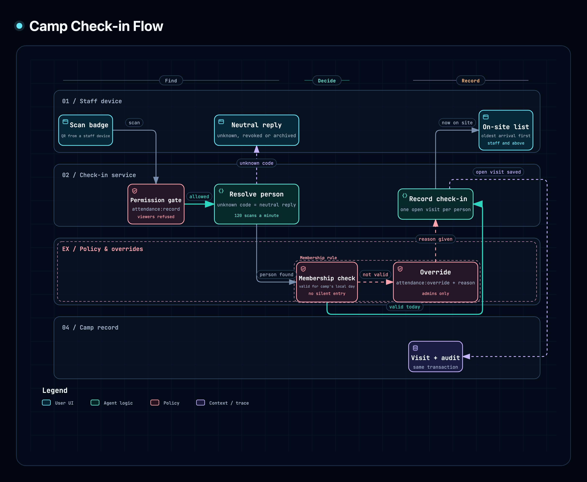
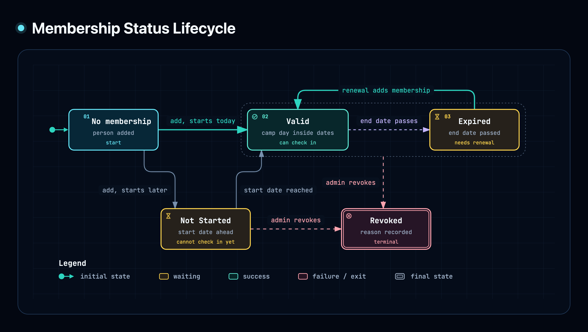
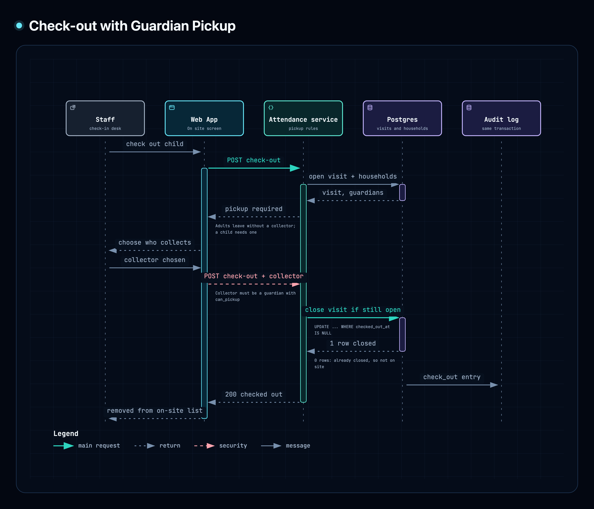

# Buxa

Camp and membership management: people and households, memberships, check-in, and a staff task board. Classes, sessions and registration are planned (see the roadmap).
Built phase by phase; see `docs/ROADMAP.md`. The repository is public, so it holds **mock data only** until the privacy work in `docs/deploy.md` is done.

**Stack:** Next.js (App Router) · TypeScript · Postgres with row-level security · Supabase sign-in. See `docs/adr/`.

## Flows

The diagrams below were made with [Archify](https://github.com/tt-a1i/archify) from the source code. They use mock data only and show how the app works, not who is in it.

Each preview links to the interactive diagram, which you can explore in the browser. The standalone HTML files are in `docs/architecture/` if you want to download them.

### Check-in

[](https://htmlpreview.github.io/?https://github.com/OUTATIME-FANBOYS/buxa/blob/develop/docs/architecture/checkin-flow.html)

[Open the interactive diagram](https://htmlpreview.github.io/?https://github.com/OUTATIME-FANBOYS/buxa/blob/develop/docs/architecture/checkin-flow.html)

Staff scan a badge on a staff device. The check-in service checks the staff member's permission, then resolves the person: an unknown or revoked code gets a neutral reply and nothing is recorded. A known person is checked against their membership for the camp's local day. If it is not valid, only an admin can override it, and only with a reason. A valid check-in records one open visit per person and adds them to the on-site list, in the same transaction as the audit entry.

### Membership lifecycle

[](https://htmlpreview.github.io/?https://github.com/OUTATIME-FANBOYS/buxa/blob/develop/docs/architecture/membership-lifecycle.html)

[Open the interactive diagram](https://htmlpreview.github.io/?https://github.com/OUTATIME-FANBOYS/buxa/blob/develop/docs/architecture/membership-lifecycle.html)

A person starts with no membership. Adding a membership that starts today makes it valid straight away, so the person can check in. A membership that starts later waits as not started until its start date arrives. When the end date passes, a valid membership expires and needs renewal, and a renewal makes it valid again. An admin can revoke a membership at any time; revoked is a terminal state with the reason recorded.

### Check-out with guardian pickup

[](https://htmlpreview.github.io/?https://github.com/OUTATIME-FANBOYS/buxa/blob/develop/docs/architecture/checkout-sequence.html)

[Open the interactive diagram](https://htmlpreview.github.io/?https://github.com/OUTATIME-FANBOYS/buxa/blob/develop/docs/architecture/checkout-sequence.html)

Staff check a child out from the on-site screen. The attendance service loads the open visit and its households. Adults can leave without a collector, but a child needs one, so staff choose who collects. The check-out then goes through again with that collector, which must be a guardian allowed to pick up. The service closes the visit only if it is still open, writes the check-out to the audit log in the same transaction, and removes the child from the on-site list. If the visit was already closed, nothing changes.

### Pickup authorisation

[](https://htmlpreview.github.io/?https://github.com/OUTATIME-FANBOYS/buxa/blob/develop/docs/architecture/pickup-authorisation.html)

[Open the interactive diagram](https://htmlpreview.github.io/?https://github.com/OUTATIME-FANBOYS/buxa/blob/develop/docs/architecture/pickup-authorisation.html)

An admin sets or clears the pickup flag on a household link. The permission check runs first and fails closed: anyone who is not an admin or owner is refused and nothing is written. An admin's request then goes to the people service, which confirms the person is a guardian before saving the link and its audit entry together. Check-out reads that link later and accepts only a guardian with the pickup flag set.

If a diagram disagrees with the code, the code wins. Fix the diagram in the same PR as the change, and re-export its PNG (see `CONTRIBUTING.md`).


## Run it locally
```bash
npm install
docker compose up -d db                       # Postgres on 127.0.0.1:5433
cp apps/web/.env.example apps/web/.env.local  # then fill in the two public Supabase values; DATABASE_URL is already set for the local database
npm run db:migrate
npm run dev                                   # http://localhost:5173  (the web app and the API are one Next.js app)
```
`npm run typecheck`, `npm test` (database tests need `DATABASE_URL`), `npm run build`, `npm start`. The first request to each page in dev mode compiles it, so give a fresh start a moment.

## Layout
```
apps/web          Next.js app: app/ (routes), features/ (attendance, auth, badge, camp, kanban, people, scanner), components/ui (shared UI), providers/, styles/, config/ (single sources), server/ (API, sessions, services)
packages/domain   pure rules: roles, permissions, slugs, ids
packages/db       migrations, transactions, tenant isolation
packages/contracts  zod shapes shared by the API and the web app
docs/             roadmap, ADRs, auth, deploy, security, seed data, phase specs, audit
```
Rules for the code are in `docs/CODING_STANDARDS.md`; how to contribute is in `docs/CONTRIBUTING.md`.

## The staff task board
The original kanban demo lives at `/kanban`. It is client-only and keeps its data in the browser. It acts as the account you sign in with; there are no browser-only demo accounts. Sample accounts for each persona will come from a later seed step that creates real Supabase accounts.
The board is kept in this browser only. Connecting agents is not available yet (it is parked on the roadmap).
