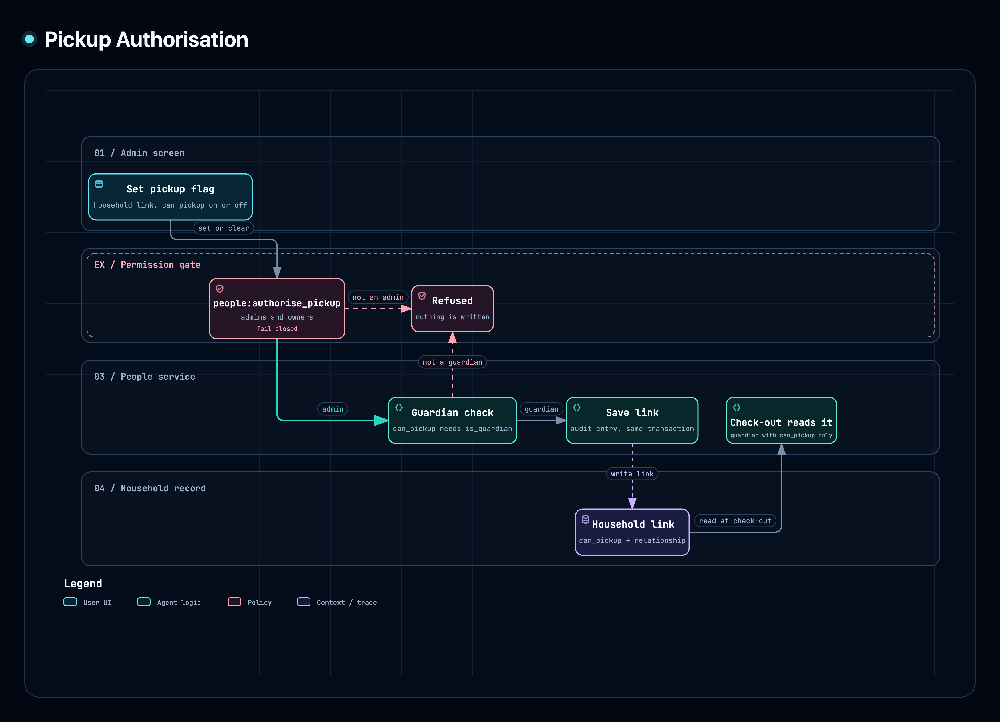

# Buxa

Camp and membership management: people and households, memberships, check-in and check-out, the on-site list, classes and sessions with enrolment, and a staff task board. Registration and payments are planned (see the roadmap).
Built phase by phase; see `docs/ROADMAP.md`. The repository is public, so it holds **mock data only**. Real children's data waits for the open items in `docs/security.md` (section 6).

**Stack:** Next.js (App Router) · TypeScript · Postgres with row-level security · Supabase sign-in. See `docs/adr/`.

## What is built

- **Home (dashboard)**, `/camp`: check-ins by day, who is on site by age, membership status, upcoming sessions and your tasks. With no camp yet, it shows the set-up form first.
- **People and households**, `/camp/people`: add and edit people, link them into households (guardians, pickup permission), and archive a person.
- **Memberships and badges**: a membership is a date range. Its status (not started, valid, expired or revoked) is computed from the dates. A badge is shown once and stored only as a hash; reissuing it revokes the old one.
- **Check-in, on site and check-out**, `/camp/check-in` and `/camp/on-site`: scan a badge or search by name. See the flows below.
- **Attendance log**, `/camp/attendance`: filters and CSV export.
- **Classes and sessions**, `/camp/classes`: classes with an age range and capacity, sessions with a time, location, instructors and capacity, enrolment (age, overlap, capacity and waitlist), and a CSV import with a preview before anything is saved. The model is in `docs/phases/02-events-calendar.md`.
- **Camp settings**, `/camp/settings`: the camp's name and clock format (12-hour or 24-hour, default 24-hour). Admins change it.
- **Team access**, `/camp/members`: the list of members. Inviting, changing roles and removing members are not built yet.
- **Staff task board**: My tasks, Projects, Boards, Calendar and Agents in the sidebar. See "The staff task board" below.
- **Help**, `/camp/help`, from the account menu: how to export and import, in plain words.

Who may do what is in `docs/auth.md` (roles and permissions).

## Flows

The diagrams below were made with [Archify](https://github.com/tt-a1i/archify) from the source code. They use mock data only and show how the app works, not who is in it.

Each preview links to the interactive diagram, which you can explore in the browser. The standalone HTML files are in `docs/architecture/` if you want to download them.

### Check-in

[](https://htmlpreview.github.io/?https://github.com/OUTATIME-FANBOYS/buxa/blob/develop/docs/architecture/checkin-flow.html)

[Open the interactive diagram](https://htmlpreview.github.io/?https://github.com/OUTATIME-FANBOYS/buxa/blob/develop/docs/architecture/checkin-flow.html)

Staff scan a badge on a staff device. The check-in service checks the staff member's permission, then resolves the person: an unknown or revoked code gets a neutral reply and nothing is recorded. A known person is checked against their membership for the camp's local day. If it is not valid, only an admin can override it, and only with a reason. A valid check-in records one open visit per person and adds them to the on-site list, in the same transaction as the audit entry.

### Membership lifecycle

[](https://htmlpreview.github.io/?https://github.com/OUTATIME-FANBOYS/buxa/blob/develop/docs/architecture/membership-lifecycle.html)

[Open the interactive diagram](https://htmlpreview.github.io/?https://github.com/OUTATIME-FANBOYS/buxa/blob/develop/docs/architecture/membership-lifecycle.html)

A person starts with no membership. Adding a membership that starts today makes it valid straight away, so the person can check in. A membership that starts later waits as not started until its start date arrives. When the end date passes, a valid membership expires, and a new membership makes the person valid again. An admin can revoke a membership at any time; revoked is a terminal state with the reason recorded.

### Check-out with guardian pickup

[](https://htmlpreview.github.io/?https://github.com/OUTATIME-FANBOYS/buxa/blob/develop/docs/architecture/checkout-sequence.html)

[Open the interactive diagram](https://htmlpreview.github.io/?https://github.com/OUTATIME-FANBOYS/buxa/blob/develop/docs/architecture/checkout-sequence.html)

Staff check a child out from the on-site screen. The attendance service loads the open visit and its households. Adults can leave without a collector, but a child needs one, so staff choose who collects. The check-out then goes through again with that collector, which must be a guardian allowed to pick up. The service closes the visit only if it is still open, writes the check-out to the audit log in the same transaction, and removes the child from the on-site list. If the visit was already closed, nothing changes.

### Pickup authorisation

[](https://htmlpreview.github.io/?https://github.com/OUTATIME-FANBOYS/buxa/blob/develop/docs/architecture/pickup-authorisation.html)

[Open the interactive diagram](https://htmlpreview.github.io/?https://github.com/OUTATIME-FANBOYS/buxa/blob/develop/docs/architecture/pickup-authorisation.html)

An admin sets or clears the pickup flag on a household link. The service checks `people:update` first, then `people:authorise_pickup` (admin and owner) whenever the flag is set or cleared, so anyone else is refused and nothing is written. A pickup flag also needs the guardian flag. The link and its audit entry are saved together. Check-out reads that link later and accepts only a guardian with the pickup flag set.

If a diagram disagrees with the code, the code wins. Fix the diagram in the same PR as the change, and re-export its PNG (see `docs/CONTRIBUTING.md`).


## Run it locally
Use Node 22, as CI does.
```bash
npm install
docker compose up -d db                       # Postgres on 127.0.0.1:5433
cp apps/web/.env.example apps/web/.env.local  # then fill in the two public Supabase values; DATABASE_URL is already set for the local database
npm run db:migrate
npm run seed:mock                             # optional: the fictional Camp Birchwood (see docs/seed.md)
npm run dev                                   # http://localhost:5173  (the web app and the API are one Next.js app)
```
`npm run typecheck`, `npm run lint`, `npm test` (database tests need `DATABASE_URL`), `npm run build`, `npm start`. The first request to each page in dev mode compiles it, so give a fresh start a moment.

## Layout
```
apps/web          Next.js app: app/ (routes only), actions/ (server action wrappers), components/ (elements, components, views), config/, styles/, proxy.ts
apps/server       the backend: services, repositories, auth, http, session, rate limiting, composers (server-only)
apps/shared       pure helpers (dates, CSV, routes, attendance and class state, QR rendering) and the browser-only staff board data
apps/middleware   client-side hooks and providers
packages/domain   pure rules: roles, permissions, classes, people rules, slugs, ids
packages/db       migrations, transactions, tenant isolation, database connection and TLS settings
packages/contracts  zod shapes shared by the server and the web app
docs/             roadmap, ADRs, auth, deploy, security, seed data, phase specs, architecture diagrams, audit
```
Rules for the code are in `docs/CODING_STANDARDS.md`; how to contribute is in `docs/CONTRIBUTING.md`.

## The staff task board
The staff board is the Work group in the sidebar: My tasks, Projects, Boards, Calendar and Agents. Reports and Help are in the account menu. It runs in the browser and keeps its data in that browser's storage. It is not on the database yet (see the "Staff board" row in `docs/ROADMAP.md`). Its sample data and the reset are in `docs/seed.md`. The old address `/kanban` redirects to `/camp`.

The old single-user server (`npm run server`, code in `apps/server/src/agents`, with an MCP endpoint for agents) is optional. To let the board sync with it, set `NEXT_PUBLIC_LEGACY_SYNC=true` and `NEXT_PUBLIC_LEGACY_SECRET` (the same value as the server's `BUXA_LEGACY_SECRET`). See `docs/security.md`.
